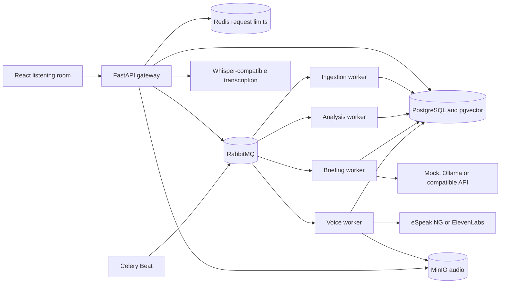

# Sourcera architecture

The browser requests listener-owned resources from a versioned FastAPI service. News processing runs once per input independently of how many listeners use it. Workers share the same schema, publication gate and provider adapters. Each worker consumes a dedicated Celery queue. Compose keeps database, storage API, cache and message ports on the internal network.

## Code ownership

| Location | Responsibility |
|---|---|
| `frontend/src/features` | Auth, settings and onboarding, discovery, player, assistant and costs |
| `backend/app/account_routes.py`, `auth.py`, `accounts.py` | Listener identities, preferences, schedules and access checks |
| `backend/app/news` | Authorized imports, normalization, embeddings, event matching and source evidence |
| `backend/app/briefing` | Ranking, structured text, final verification, audio caching and discussion |
| `backend/app/jobs.py` | Task dispatch, retries, schedule and RSS discovery |
| `backend/app/messaging.py` | Versioned domain events, publisher confirms, durable inbox receipts |
| `backend/app/usage.py` | Usage observations and separately priced projections |
| `backend/alembic` | Versioned schema and vector index |

A briefing moves through queued, processing, script ready, audio generating and completed or failed. The database serializes stage ownership. The frontend can recover the current state by HTTP after disconnecting. The synchronized player consumes actual PCM segment durations returned by the audio worker.

For the local development profile, a single-thread worker and SQLite use the same source import, ranking, verification and speech implementations. The Compose deployment exercises broker delivery, database locks, pgvector retrieval and S3-compatible object storage.
