# Database and provenance

The initial Alembic revision defines 29 application tables plus Alembic's revision table. PostgreSQL stores UUID identifiers in 36-character columns so the same identity representation works in the SQLite development database. Every domain record has a creation timestamp. The migration enables pgvector and creates an HNSW cosine index for 384-dimensional vectors.

```mermaid
erDiagram
    ingestion_jobs ||--o{ articles : job_id
    articles o|--o{ articles : near_duplicate_of
    sources ||--o{ articles : source_id
    users ||--o{ briefing_schedules : user_id
    generated_audio o|--o{ briefings : audio_id
    users ||--o{ briefings : user_id
    model_usage ||--o| cost_events : usage_id
    stories ||--o{ facts : story_id
    stories ||--o{ listening_history : story_id
    users ||--o{ listening_history : user_id
    stories ||--o{ source_disagreements : story_id
    stories ||--o{ story_topics : story_id
    stories ||--o{ user_feedback : story_id
    users ||--o{ user_feedback : user_id
    users ||--o{ user_interests : user_id
    users ||--o| user_preferences : user_id
    voice_profiles ||--o{ user_preferences : voice_profile_id
    sources ||--o{ user_sources : source_id
    users ||--o{ user_sources : user_id
    articles ||--o| article_embeddings : article_id
    briefings ||--o{ briefing_items : briefing_id
    stories ||--o{ briefing_items : story_id
    briefings ||--o{ briefing_segments : briefing_id
    stories o|--o{ briefing_segments : story_id
    articles ||--o{ claim_evidence : article_id
    facts ||--o{ claim_evidence : fact_id
    briefings o|--o{ conversations : briefing_id
    stories o|--o{ conversations : story_id
    users ||--o{ conversations : user_id
    articles ||--o| story_articles : article_id
    stories ||--o{ story_articles : story_id
    briefings o|--o{ conversation_messages : briefing_id
    conversations ||--o{ conversation_messages : conversation_id
    stories o|--o{ conversation_messages : story_id
    processing_jobs {
        string id PK
        string kind
        string entity_id
        string status
        int attempts
    }
    event_outbox {
        string id PK
        string entity_id
        string routing_key
        string correlation_id
    }
    event_receipts {
        string id PK
        string entity_id
        string routing_key
    }
```

Foreign keys above describe database-enforced relationships. Processing jobs, domain envelopes and receipts carry polymorphic entity IDs. The receipt primary key matches the producer-assigned event ID. The unique pair of stage and entity identifies work across retries.

## Reading a statement back to the source

1. Locate its briefing segment and its claim and article identifiers.
2. Resolve the claim in `facts` and its source excerpt in `claim_evidence`. Offsets address the normalized article's Unicode text.
3. Check the original publication metadata through `articles.source_id` and `sources`. The article also records its ingestion job, language, content hash, timestamps and near-copy relationship.
4. Source disagreements retain all competing claim IDs. The transcript stores the citation snapshot used when producing that edition. Generated audio stores an object key, duration and segment boundaries; the WAV lives in object storage.

The schema enforces one active article-to-story assignment per article, one embedding per article, one copy of each fact/span/article link, ordered segment uniqueness, one daily edition per schedule key and content-derived audio cache uniqueness. JSON arrays hold small immutable citation and request snapshots. Filtering and joining articles, sources, topics and claims uses relational tables and indexes.

## Schema operations

From the backend directory with `DATABASE_URL` set, run `python -m alembic upgrade head` or `python -m app.cli bootstrap`. The revision uses explicit DDL independent of the live application models. PostgreSQL installs the vector extension inside the application database. The SQLite migration stores embeddings as JSON and the analysis layer evaluates cosine candidates in process.
