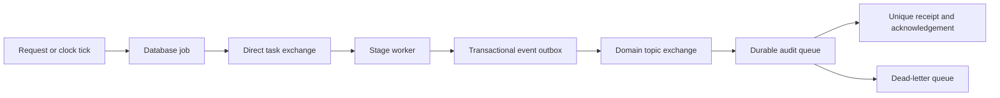

# Messages and recovery

The service writes a domain event to `event_outbox` inside the transaction that changes the corresponding entity. The Beat tick publishes pending rows with delivery mode 2 and publisher confirms. The envelope contains version, event ID, routing key, entity ID, correlation ID and UTC timestamp. Source documents and spoken payloads stay in their respective stores.

| Topic exchange | Routing keys |
|---|---|
| `news.events` | news.ingest.requested, news.article.created, news.article.normalized, news.article.failed, news.story.created, news.story.updated, news.analysis.completed |
| `briefing.events` | briefing.requested, briefing.generation.started, briefing.script.ready, briefing.verification.failed, briefing.audio.requested, briefing.audio.ready, briefing.completed, briefing.failed |
| `voice.events` | voice.transcription.requested, voice.transcription.completed, voice.synthesis.requested, voice.synthesis.completed |

Each exchange feeds `domain.<family>.audit`. A valid event inserts one receipt keyed by event ID before acknowledgement. Redeliveries are safe. Invalid version or schema sends the message to `domain.dead` and `domain.dead.letters`. A failed producer retries with bounded exponential delay. After eight attempts its outbox row stays visible as dead. After correcting the cause, run `./scripts/compose.sh exec api python -m app.cli replay-events`.

The direct exchange `sourcera.tasks` carries Celery jobs by ID. Four queues correspond to ingestion, analysis, briefing and voice. Workers acknowledge after execution. A PostgreSQL advisory lock serializes attempts for a specific processing job, including across service commits. Completed stages are replayable. A five-minute dispatch lease recovers interrupted publication. Beat revisits pending work every 15 seconds. The fourth failed stage attempt becomes terminal. Deterministic validation failures stop earlier. Operators can inspect `processing_jobs` and retry terminal stages by ID with `app.cli retry`. Listeners can retry their failed briefing through its authenticated endpoint.

A daily schedule uses its IANA zone and a unique schedule/date key. The first tick at or after the wall-clock time generates the edition. In a spring gap the next valid local time qualifies. The repeated autumn hour keeps the same key. An outage can catch up the current local date. Feed polling has its own global interval.

The Compose bootstrap declares domain topology idempotently. Worker startup declares its task queues. Aggregate queue depth is available on the loopback RabbitMQ management port. [RabbitMQ acknowledgement and confirmation semantics](https://www.rabbitmq.com/docs/confirms) · [Celery routing](https://docs.celeryq.dev/en/stable/userguide/routing.html)
