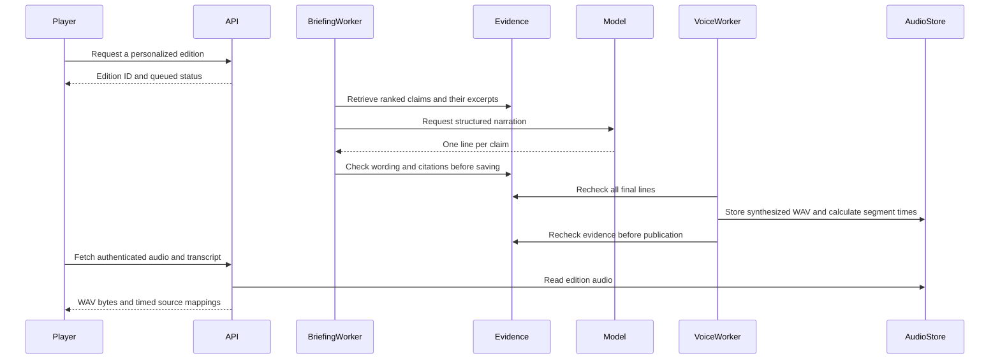
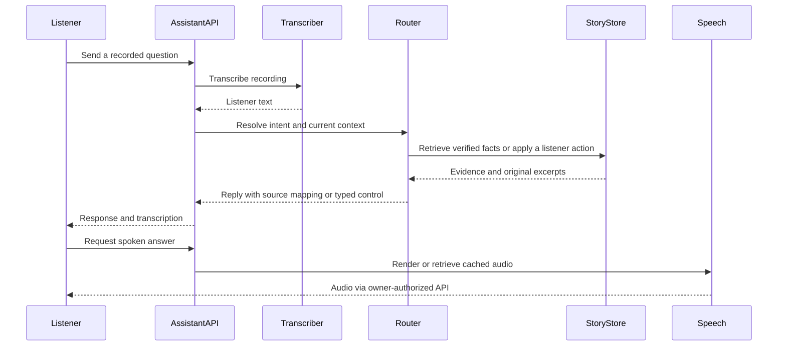

# Streamed voice conversations

## Per-listener speech-to-speech engines

Choose **OpenAI Realtime** or **ElevenLabs Realtime** in the listening room, or under Settings → Voice & language. `user_preferences.voice_engine` persists this choice independently for each listener. Switching the engine or character closes the old voice transport; prepared audio remains independent. Replies and More news are spoken, without a visible answer transcript.

- **OpenAI Realtime** uses `gpt-realtime-2.1` by default, direct WebRTC audio and 450 ms server VAD. The server resolves each character's OpenAI voice and speaking style before SDP negotiation. No model API key leaves the backend.
- **ElevenLabs Realtime** uses a private ElevenAgents agent configured with `conversation_config.realtime_model=eleven_realtime_v1_max` for reliable multi-step research tools in Russian. The browser opens a signed WebSocket and sends the selected character voice, language and bounded verified context. This is native ElevenLabs Realtime, rather than a separately selected GPT + TTS pipeline. Microphone input is PCM in 20 ms AudioWorklet frames; server audio is played immediately through the shared Safari-safe PCM queue. No microphone is requested merely to hear More news. Muting releases the microphone while the voice response continues.

The output queue detects a stopped audio clock and offers **Enable sound** when Safari requires a fresh gesture. Resuming keeps the buffered answer. Interruptions discard old audio, sign-out releases both transports, and idle voice connections close after two minutes.

## Character defaults and personal voices

`voice_profiles` stores `elevenlabs_voice_id`, `openai_voice` and `persona`. Bootstrap seeds distinct voices for the anchor, assistant, Donald Trump AI character, street casual, cyberpunk and CJ / GTA Gangsta character style. The Donald Trump preset uses the cloned voice created from the owner’s audio reference; choosing it selects ElevenLabs so the recording-based voice is used. Its stable internal slug remains `energetic` to retain existing preferences. The CJ preset is a fictional delivery style using the configured voice, not an official game recording. Prepared ElevenLabs narration also resolves its voice from this table.

**Add voice** opens the personal character editor. Name, delivery style, pending sample, cloned voice ID and activation are stored on the authenticated user's row. A 30–60 second recording up to 10 MiB is validated before cloning. A personal account and ElevenLabs key with voice-creation access are needed to clone; demo listeners can save a pending sample. After cloning, the raw pending sample is cleared. The saved character is available only to its owner. Selecting it chooses ElevenLabs; selecting OpenAI deactivates the custom voice while retaining it for later.

## Server setup

Keep `CONVERSATION_PROVIDER=local` so legacy application endpoints remain available; it no longer selects the new UI's engine. Configure `REALTIME_ENABLED=1` and `OPENAI_API_KEY` (or `LLM_API_KEY`) for OpenAI. Configure `ELEVENLABS_API_KEY` and `ELEVENLABS_AGENT_ID` for ElevenLabs. GET `/voice-engines` reports which providers are configured.

`python -m app.briefing.agent_setup` provisions a private native Realtime agent when no agent ID is set. Save its returned ID in the private `.env`. Its configuration enables signed authentication, voice/language overrides, dynamic variables `sourcera_context` and `sourcera_persona`, and the verified-news client tools. Realtime access must be available to the ElevenLabs workspace. The managed agent model ignores stored LLM/TTS settings; those remain valid backup configuration.

Licensed news exports are excluded from agent context unless `ELEVENLABS_ALLOW_LICENSED_CONTEXT=1` is explicitly configured for that deployment.

Legacy clients may still opt into GPT text → ElevenLabs TTS with `speech_stream=true` and `REALTIME_SPEECH_PROVIDER=elevenlabs`; the new OpenAI selection explicitly negotiates native audio instead.

[ElevenLabs Realtime models](https://elevenlabs.io/docs/eleven-agents/customization/realtime-models) · [Agent WebSockets](https://elevenlabs.io/docs/eleven-agents/libraries/web-sockets) · [OpenAI Realtime](https://developers.openai.com/api/docs/guides/realtime-conversations)

## Prepared speech and recorded conversations

The configured conversation provider receives the current story, briefing and topic, listener preferences, recent messages and retrieved evidence. Neural article embeddings support cross-language retrieval. Structured answers cite an allowlisted claim per sentence and pass the database-backed wording/evidence gate. The router resolves follow-up references from recent history. Recorded-answer provider or verification failures recover to verified source wording. Conversation screens play replies aloud and never render their text.

Current-story questions preserve the selected conversation story, including stories added through **More news**. Unsupported conversational rewrites recover to the cited source wording and pass the evidence gate again. Invalid claim identities and invalid stored evidence still block the generated response.

Prepared daily editions contain the three highest-ranked eligible stories when three are available. The `story_limit` request field also supports explicitly bounded custom editions. The listening room offers **More news**, and the voice router recognizes equivalent requests in English, German, Dutch and Russian. Each request selects up to three additional stories, excluding the original briefing and earlier conversation selections.

ElevenLabs narration batches verified paragraphs through the timestamped speech endpoint. Original character alignment determines transcript boundaries, and audio frame counts determine the final duration. Batches stay within 8,000 characters. The local renderer retains segment-by-segment synthesis. Unsupported generated rewrites are replaced with their approved source wording before the final evidence gate. Invalid claim IDs, assignments or source evidence still block publication.

Hosted deployment uses API-based narration rewrites and separately verifies the resulting wording. `STT_PROVIDER=elevenlabs` enables Scribe transcription with `ELEVENLABS_STT_MODEL`. The existing `whisper` provider supports a compatible transcription API. Decoded recording duration can be priced with `STT_USD_PER_MINUTE`.

## Generating an edition

The briefing worker supplies one vetted source claim per structured line. Successful and rejected API attempts retain their provider usage counters, elapsed time and reported token counts. The ledger stores model identifiers and usage quantities. If an external API fails before returning counts, the ledger records the attempt with zero reported tokens and an unknown charge. The provider can use a compatible chat-completions service, Ollama, or the deterministic local adapter. All outputs pass Pydantic validation and a separate database-backed verification gate. A malformed provider response or network error falls back to the original retrieved claims. A schema-valid draft that changes a fact fails verification and cannot be published. Verify changed wording at the final stage before creating speech.

Introductory and transitional lines come from a fixed English, German or Dutch vocabulary. Each factual line carries a claim ID, original article IDs, publisher names, URLs and exact source excerpts. The transcript discloses conflicting reporting with a fixed marker when the selected story has a recorded disagreement. Source comparison gives the competing accounts with attribution. Only supported claims enter factual narration.

Audio uses signed-in API routes. MinIO stores the file, and the database stores its key, provider, SHA-256 cache key, duration and boundaries. Cache keys include ordered segment text, language, speaker style and the active voice/model configuration. Playback times are calculated from the actual PCM frame count, including the short gap between segments. The cache is shared for identical audio. Access to each edition and spoken conversation answer still requires its owner's token.

The studio's “Create with this voice” action revoices the current completed episode. It copies the approved script and story order into a listener-owned edition and commits a voice job in the same transaction. It skips the briefing writer, keeps both evidence checks around synthesis, and uses the same audio cache. Weekly edition creation continues to retrieve and write a new script.

## Provider configuration

| Variable | Meaning |
| --- | --- |
| `LLM_PROVIDER` | `mock`, `api` or `ollama` |
| `LLM_BASE_URL` | Chat API base including `/v1` for an OpenAI-compatible service, or Ollama server origin |
| `LLM_MODEL`, `LLM_API_KEY` | Selected model and optional bearer credential. Defaults are `gpt-4o-mini` for API and `llama3.2` for Ollama |
| `TTS_PROVIDER` | `local` or `mock` for eSpeak NG, or `elevenlabs` |
| `ELEVENLABS_API_KEY`, `ELEVENLABS_VOICE_ID` | Service credential and a voice the operator has permission to use |
| `ELEVENLABS_VOICE_MAP` | Optional JSON object mapping Sourcera voice slugs to permitted external voice IDs |
| `ELEVENLABS_MODEL` | Defaults to `eleven_multilingual_v2` |
| `TTS_LOCAL_FALLBACK` | Defaults to `1`. Use local spoken narration after a configured ElevenLabs network or decoding failure. Set `0` to propagate that error |
| `CONVERSATION_PROVIDER` | `local` for the local demo or `elevenagents` for live voice |
| `ELEVENLABS_AGENT_ID` | Private ElevenAgents agent used to start signed voice sessions |
| `STT_PROVIDER` | Local-demo recording provider. Supports `mock`, `whisper` and `elevenlabs` |
| `STT_BASE_URL`, `STT_API_KEY`, `STT_MODEL` | Transcription API base, bearer credential and model. Defaults to the OpenAI v1 API and `whisper-1` |
| `AUDIO_STORAGE`, `AUDIO_DIR` | `minio` in Compose. Local development uses `local` and an operator-selected directory |
| `MINIO_ENDPOINT`, `MINIO_ACCESS_KEY`, `MINIO_SECRET_KEY`, `MINIO_BUCKET` | Private S3-compatible endpoint, credentials and bucket name |

The five speaker styles use original variations in offline pacing and pitch. The local speech renderer works without API keys. The Compose image includes eSpeak NG and FFmpeg. On macOS the backend dependency provides the corresponding shared library. Real ElevenLabs audio is normalized to mono 22.05 kHz before files are combined. Briefing detail reports which provider rendered the final audio. External accounts and models must be available for live provider use. [ElevenLabs speech endpoint](https://elevenlabs.io/docs/api-reference/text-to-speech/convert) · [Ollama structured outputs](https://docs.ollama.com/capabilities/structured-outputs)

## Local-demo conversational playback

`POST /conversations` accepts a briefing ID or story ID. Ordinals resolve against that briefing's ordered items. The conversation retains the active story, selected topic, prior messages and language. Follow-ups use the active story for requests such as “give me more details.” Named questions search recent story summaries, then score the eligible evidence in the strongest candidates. Numeric questions require a numeric evidence line. An ordinal after a news digest resolves against the exact lineup read in that digest. Topic matches, source exclusions and prior responses affect the resulting selection. Source comparison quotes disagreements directly with attribution. Explain, skip, pause and voice changes use typed actions. Changing preferences through the assistant opens the settings form.

The mock transcription endpoint accepts a UTF-8 `text/plain` file. Browser recordings require Whisper. The endpoint accepts a maximum of 10 MiB of audio, and checks that the authenticated listener owns the conversation. The text path is available in every configuration. [Whisper-compatible recording upload](https://platform.openai.com/docs/guides/speech-to-text)

## Prepared daily playback and continuous voice turns

The home page prepares the signed-in listener's daily edition before playback. A stable daily/user/local-date key returns the same baseline through repeated requests and schedule ticks. Professional news is the baseline voice. New listeners get a 06:00 schedule in their preferred time zone when they have no schedule. Existing explicit schedules and disabled schedules are respected. The synthetic technology and finance templates are prepared by the scheduler ahead of login, and compatible demo listeners receive private segment and item records referencing the same immutable audio. A genuinely new preference set needs its first preparation before Play becomes available.

POST /api/v1/briefings/daily returns the daily edition and asynchronously dispatches it if needed. The homepage downloads its authenticated audio before enabling Play. Clicking Play invokes the audio element directly without a generation request. Changing preferences preserves the baseline. The separate regeneration action creates a new edition with the current settings.

Playback also requests microphone permission. The microphone is held only for the visible session. Echo cancellation and noise suppression are requested. An analyser detects sustained speech, pauses narration and cancels stale response playback. Encoded utterances are submitted after roughly 760 ms of silence. Silent capture windows are discarded and memory is bounded. The latest turn wins when a listener interrupts an answer. Source context follows the currently playing story. Source evidence remains visible with the reply.

In the local/demo conversation path, `STT_PROVIDER=elevenlabs` uses the Scribe multipart endpoint with `ELEVENLABS_STT_MODEL`, which defaults to `scribe_v2`. Whisper and the deterministic text-transcript adapter are available in that path.

Say “continue” (also “продолжай”) to resume the saved briefing. Pause, skip and source-comparison commands use typed actions. Turning the microphone off or leaving the page releases all capture tracks. The microphone can remain active after the recording ends for follow-up questions. Playback still works if microphone permission is denied. Hands-free interruption needs a supported browser on localhost or HTTPS, with headphones recommended for echo isolation. This implementation performs turn-based recognition and synthesis, with network and provider delay between speech and the spoken response.
